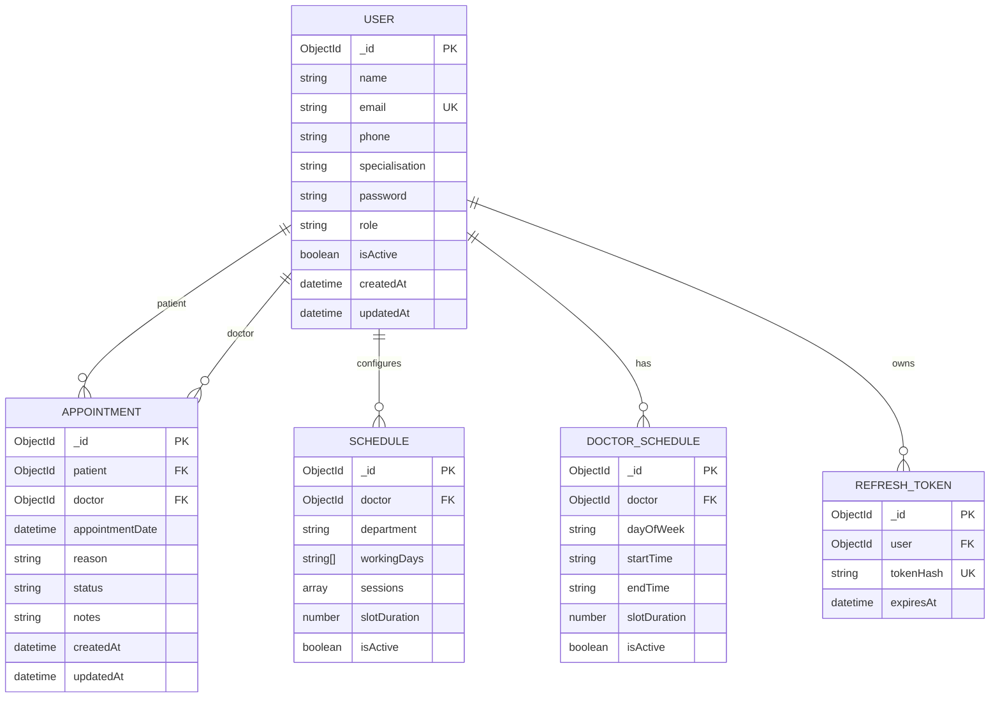

# EMR Appointment System — Database Schema

## Entity Relationship Diagram

## Collections

### 1. User
Stores account information for Super Admins, Receptionists, Doctors, and Patients.

- name
- email (unique)
- phone
- specialisation (required for doctors)
- password (excluded from query results by default)
- role
- isActive
- createdAt, updatedAt

### 2. Appointment
Stores appointment bookings and their status.

- patient — reference to User
- doctor — reference to User
- appointmentDate
- reason
- status: PENDING, CONFIRMED, ARRIVED, COMPLETED, CANCELLED
- notes
- createdAt, updatedAt

### 3. Schedule
Stores doctor working days, sessions, break timings, department, and slot duration.

### 4. DoctorSchedule
Stores a doctor's schedule by weekday and time range.

### 5. RefreshToken
Stores hashed refresh tokens, user references, and expiry dates.

## Indexes

- User: unique email index.
- Appointment: patient + appointmentDate.
- Appointment: doctor + appointmentDate.
- Schedule: doctor + isActive.
- DoctorSchedule: unique doctor + dayOfWeek + startTime + endTime.
- RefreshToken: unique tokenHash and user index.
- RefreshToken: TTL index on expiresAt for expired token cleanup.

## Design Notes

- Appointment patient and doctor references point to User documents.
- Schedule and DoctorSchedule currently overlap in purpose; confirm whether both are required.
- Appointment indexes support date-based queries but do not, by themselves, prevent simultaneous double bookings.
- Verify Patient.js, Doctor.js, and AuditLog.js before documenting additional collections.
